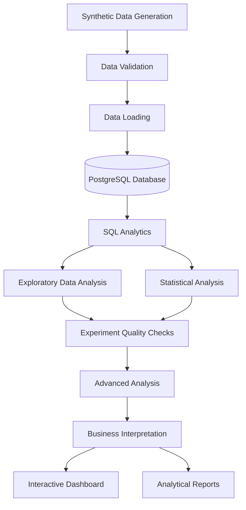

# ExperimentLab — End-to-End A/B Testing & Experimentation Analytics Platform

<p align="center">
  <strong>A production-inspired analytics platform for designing, evaluating, and interpreting A/B experiments.</strong>
</p>

<p align="center">
  Python · Pandas · NumPy · SciPy · SQL · PostgreSQL · Docker · Streamlit · Plotly · Pytest
</p>

---

## Table of Contents

- [Overview](#overview)
- [Business Problem](#business-problem)
- [Project Objectives](#project-objectives)
- [Architecture](#architecture)
- [Key Features](#key-features)
- [Statistical Methodology](#statistical-methodology)
- [Data Engineering](#data-engineering)
- [Exploratory Data Analysis](#exploratory-data-analysis)
- [Experiment Quality and Advanced Analysis](#experiment-quality-and-advanced-analysis)
- [Dashboard](#dashboard)
- [Technology Stack](#technology-stack)
- [Repository Structure](#repository-structure)
- [Getting Started](#getting-started)
- [Running the Analysis](#running-the-analysis)
- [Testing and Quality Assurance](#testing-and-quality-assurance)
- [Reports and Documentation](#reports-and-documentation)
- [Important Statistical Considerations](#important-statistical-considerations)
- [Limitations](#limitations)
- [Future Improvements](#future-improvements)

---

## Overview

**ExperimentLab** is an end-to-end A/B testing analytics platform built to simulate, process, analyze, and interpret controlled experiments in an e-commerce environment.

The project demonstrates how an experimentation workflow can be organized beyond a single statistical test or Jupyter Notebook.

It combines:

- Reproducible synthetic data generation.
- Data validation and quality checks.
- Relational database integration.
- Analytical SQL queries.
- Exploratory Data Analysis (EDA).
- Statistical hypothesis testing.
- Confidence intervals and effect-size estimation.
- Experiment quality diagnostics.
- Advanced statistical methods.
- Interactive analytical dashboards.
- Automated testing and reproducibility checks.

The platform follows a modular architecture: data generation, database operations, statistical calculations, business interpretation, and dashboard presentation are separated into independent components.

**The goal is not simply to calculate a p-value. It is to build a complete workflow that helps determine whether an experiment is reliable, whether the observed effect is statistically supported, and whether the result is meaningful from a business perspective.**

## Business Problem

Imagine an e-commerce company redesigning its checkout page.

The product team believes that a new checkout experience will increase the percentage of users who complete a purchase.

The company runs a controlled experiment:

| Group | Experience |
|---|---|
| Control (A) | Existing checkout |
| Treatment (B) | Redesigned checkout |

Users are assigned to one of the two groups, and their behavior is observed during the experiment.

The central business question is:

**Does the redesigned checkout improve conversion without negatively affecting other important business metrics?**

To answer this question, the analysis evaluates:

1. Whether the experiment groups are sufficiently balanced.
2. Whether the observed conversion difference is statistically significant.
3. How large the estimated effect is.
4. Whether revenue-related metrics support the same conclusion.
5. Whether the result is consistent across user segments.
6. Whether experiment quality issues could undermine the conclusion.
7. Whether the observed improvement is meaningful enough to support a business decision.

## Project Objectives

The project was designed to demonstrate practical knowledge of several Data Science and Analytics areas.

| Area | Objective |
|---|---|
| Python | Build a modular and reusable analytics application |
| Data Engineering | Generate, validate, load, and process experimental data |
| SQL | Perform analytical queries and database-level transformations |
| Statistics | Apply appropriate hypothesis tests and confidence intervals |
| Experimentation | Evaluate experiment validity and potential statistical pitfalls |
| EDA | Explore distributions, relationships, and group differences |
| Visualization | Communicate findings through charts and dashboards |
| Software Engineering | Apply modular architecture, configuration, logging, and automated tests |

## Architecture

ExperimentLab uses a modular pipeline that separates data processing from statistical analysis and presentation.



### Main architectural components

**1. Data generation**

Creates reproducible synthetic user-level experimental datasets with configurable experiment scenarios.

**2. Data validation**

Checks input data and experimental records before they enter the analytical pipeline.

**3. Database layer**

Loads data into PostgreSQL and provides structured SQL operations for analytical queries and integrity checks.

**4. Analysis layer**

Contains independent modules for descriptive statistics, conversion analysis, revenue analysis, hypothesis testing, and advanced experimentation methods.

**5. Application layer**

Presents analytical results through an interactive dashboard.

**6. Quality assurance**

Uses automated tests to validate statistical calculations, data handling, business rules, and application behavior.

## Key Features

### 1. Synthetic Data Generation

The project includes a configurable data-generation pipeline.

Relevant components:

- `src/experimentlab/data/generator.py`
- `scripts/generate_data.py`
- `scripts/build_experiments.py`
- `configs/experiment.yaml`

The generated data represents user-level e-commerce activity and supports multiple experiment scenarios.

The repository includes:

- Raw user data.
- Generated experiment datasets.
- Processed-data storage.
- Simulation metadata.

A fixed random seed can be used to support reproducible simulations.

The simulation truth file is kept separate from the analytical results. It can be used to validate the behavior of the synthetic-data generator, but it must not be used as an input to the experiment's statistical decision.

### 2. Data Validation and Database Integration

ExperimentLab integrates Python data processing with a relational database.

Relevant components:

- `src/experimentlab/db/`
- `sql/01_schema.sql`
- `sql/02_upsert_from_staging.sql`
- `sql/04_integrity_checks.sql`
- `scripts/load_to_db.py`

The database layer supports:

- Database connection management.
- Schema initialization.
- Loading experimental data.
- Staging and upsert operations.
- Data validation.
- Integrity checks.
- Analytical data extraction.

The SQL layer also includes examples of:

- Filtering and aggregation.
- `GROUP BY` and `HAVING`.
- Common Table Expressions (CTEs).
- `CASE WHEN`.
- Window functions.
- Ranking.
- Percentile calculations.

Additional analytical queries are available in `sql/queries/`.

### 3. Exploratory Data Analysis

EDA is implemented as a separate analytical stage.

Relevant components:

- `src/experimentlab/analysis/eda.py`
- `notebooks/01_eda.ipynb`
- `notebooks/eda_source.py`

The analysis explores:

- Data distributions.
- Missing values.
- Potential outliers.
- Conversion differences between experiment groups.
- Revenue distributions.
- Relationships between numerical variables.
- Group balance.
- User-segment behavior.
- Device and acquisition-source patterns.
- Time-related patterns.

Generated visualizations are stored in `reports/figures/`.

### 4. Statistical Analysis

The statistical engine is organized into separate modules rather than placing all calculations in one script.

Relevant components include:

- `conversion.py`
- `revenue.py`
- `descriptive.py`
- `hypothesis.py`
- `engine.py`
- `interpretation.py`
- `decision.py`
- `power.py`

The analytical workflow evaluates conversion and revenue-related outcomes, estimates experiment effects, and supports statistical interpretation.

### 5. Interactive Dashboard

The application layer separates chart creation, reusable UI components, data services, and individual dashboard views.

Relevant components:

- `src/experimentlab/app/dashboard.py`
- `src/experimentlab/app/charts.py`
- `src/experimentlab/app/components.py`
- `src/experimentlab/app/views/`

Dashboard views include:

- Overview.
- Metrics.
- Statistical results.
- Experiment quality.
- Segmentation.
- Business interpretation.

## Statistical Methodology

A/B testing requires more than comparing two percentages. The choice of statistical method depends on the metric, its distribution, and the assumptions of the test.

ExperimentLab organizes its statistical functionality into dedicated modules.

### Conversion Analysis

Conversion is a binary outcome: a user either converts or does not convert.

The analysis compares conversion rates between Control and Treatment.

The two-proportion Z-test is used for comparing independent conversion proportions when its assumptions are appropriate.

Key metrics:

| Metric | Description |
|---|---|
| Control conversion rate | Conversion rate in group A |
| Treatment conversion rate | Conversion rate in group B |
| Absolute lift | Difference between treatment and control rates |
| Relative lift | Relative change in conversion |
| P-value | Evidence against the null hypothesis under the test assumptions |
| Confidence interval | Range of plausible values for the estimated effect |

### Revenue Analysis

Revenue metrics often have skewed distributions and may contain many zero values.

The project includes separate revenue-analysis functionality and advanced resampling methods.

The analytical workflow considers:

- Average revenue per user (ARPU).
- Revenue differences between groups.
- Revenue distribution.
- Confidence intervals.
- Bootstrap-based estimation.

### Hypothesis Testing

The statistical workflow uses the standard hypothesis-testing framework:

- Null hypothesis (H₀).
- Alternative hypothesis (H₁).
- Significance level (α).
- Test statistic.
- P-value.
- Confidence interval.
- Statistical decision.

The result is interpreted in the context of the experiment rather than as an isolated p-value.

### Statistical Power

The power-analysis component supports reasoning about:

- Minimum Detectable Effect (MDE).
- Required sample size.
- Statistical power.
- Significance level.
- Experiment planning.

The purpose is to understand whether an experiment has enough statistical sensitivity to detect an effect of practical interest.

## Data Engineering

The project includes a database-oriented workflow rather than relying exclusively on in-memory DataFrame operations.

### Database workflow

```text
Synthetic Data
      |
      v
Data Validation
      |
      v
Staging / Loading
      |
      v
PostgreSQL
      |
      v
SQL Transformations
      |
      v
Analytical Dataset
```

### SQL topics demonstrated

The SQL query collection covers several commonly used analytical patterns:

| Query | Main concept |
|---|---|
| `q01_group_summary.sql` | Group-level aggregation |
| `q02_segments_having.sql` | Segment filtering and HAVING |
| `q03_lift_cte_case.sql` | CTEs and conditional calculations |
| `q04_cumulative_window.sql` | Window functions and cumulative calculations |
| `q05_top_countries_rank.sql` | Ranking and country-level analysis |
| `q06_order_value_percentiles.sql` | Percentile analysis |

Database schema documentation is available in `docs/database_schema.md`.

## Experiment Quality and Advanced Analysis

A statistically significant result does not automatically mean that an experiment is trustworthy.

ExperimentLab includes additional methods to investigate experiment reliability and the stability of observed results.

### Sample Ratio Mismatch (SRM)

Checks whether the observed distribution of users across experiment groups is consistent with the expected assignment ratio.

A potential SRM can indicate assignment, instrumentation, or data-processing problems that require investigation.

### Bootstrap Analysis

Uses resampling to estimate uncertainty around metrics and differences between groups.

### Segmentation

Supports examining experiment outcomes across user subgroups.

Examples include:

- Device type.
- Acquisition source.
- Country.
- Other available user attributes.

Segment-level results should be interpreted carefully because testing many segments increases the risk of false-positive findings.

### Multiple Testing

The project includes functionality for multiple-comparison correction.

Methods include:

- Bonferroni correction.
- Benjamini–Hochberg False Discovery Rate (FDR) procedure.

### Guardrail Metrics

Guardrails help detect whether an apparent improvement in the primary metric is accompanied by negative changes elsewhere.

Examples of business guardrails include:

- Revenue per user.
- Average order value.
- Refund-related metrics, where available.
- Checkout abandonment, where available.

### Sensitivity Analysis

Evaluates how conclusions may change under alternative analytical assumptions or approaches.

Relevant modules:

- `advanced_engine.py`
- `bootstrap.py`
- `experiment_quality.py`
- `guardrails.py`
- `multiple_testing.py`
- `power.py`
- `segments.py`
- `sensitivity.py`
- `srm.py`

## Dashboard

ExperimentLab includes an interactive dashboard designed to make experiment results easier to explore and communicate.

The dashboard is built using a modular application structure.

| View | Purpose |
|---|---|
| Overview | High-level experiment summary |
| Metrics | Explore key performance metrics |
| Statistical | Review statistical results |
| Quality | Investigate experiment quality |
| Segmentation | Compare results across user segments |
| Business | Present business-oriented interpretation |

The dashboard is intended to present results from the analytical layer rather than duplicate statistical calculations inside the UI.

**Dashboard screenshots**

Add screenshots from your actual running application here:

```text
docs/screenshots/
├── overview.png
├── metrics.png
├── statistical.png
├── quality.png
└── segmentation.png
```

Once the screenshots exist, you can embed them using:

```markdown

```

## Technology Stack

| Technology | Purpose |
|---|---|
| Python | Core programming language |
| NumPy | Numerical operations and simulation |
| Pandas | Data manipulation and analysis |
| SciPy | Statistical calculations |
| PostgreSQL | Relational database |
| SQLAlchemy | Database connectivity |
| SQL | Analytical queries and transformations |
| Matplotlib / Seaborn / Plotly | Data visualization |
| Streamlit | Interactive dashboard |
| Docker | Containerized environment |
| Pytest | Automated testing |
| Jupyter Notebook | Exploratory analysis |

Check `pyproject.toml` for the project's actual dependency declarations and supported Python version.

## Repository Structure

The following is a simplified view of the repository. Generated bytecode, cache directories, and package metadata are omitted.

```text
ExperimentLab/
│
├── configs/
│   └── experiment.yaml
│
├── data/
│   ├── experiments/
│   ├── processed/
│   ├── raw/
│   └── simulation/
│
├── docker/
│   └── init.sh
│
├── docs/
│   ├── advanced_methods.md
│   ├── architecture.md
│   ├── database_schema.md
│   ├── data_dictionary.md
│   └── statistical_methods.md
│
├── notebooks/
│   ├── 01_eda.ipynb
│   └── eda_source.py
│
├── reports/
│   ├── figures/
│   ├── analysis_results.json
│   ├── eda_report.html
│   └── statistical_report.md
│
├── scripts/
│   ├── aa_demo.py
│   ├── build_experiments.py
│   ├── check_against_truth.py
│   ├── generate_data.py
│   ├── load_to_db.py
│   ├── run_advanced.py
│   ├── run_analysis.py
│   ├── run_qa.sh
│   └── run_queries.py
│
├── sql/
│   ├── 01_schema.sql
│   ├── 02_upsert_from_staging.sql
│   ├── 03_user_analytics.sql
│   ├── 04_integrity_checks.sql
│   ├── 05_eda_extract.sql
│   └── queries/
│
├── src/
│   └── experimentlab/
│       ├── analysis/
│       ├── app/
│       │   └── views/
│       ├── data/
│       └── db/
│
├── tests/
│
├── docker-compose.yml
├── Dockerfile
├── pyproject.toml
└── README.md
```

## Getting Started

### Prerequisites

Before running the project, make sure the following are available:

- Python version supported by `pyproject.toml`.
- Docker and Docker Compose.
- Git.
- PostgreSQL, if running the database outside Docker.

### 1. Clone the repository

```bash
git clone YOUR_GITHUB_REPOSITORY_URL
cd YOUR_REPOSITORY_DIRECTORY
```

### 2. Create a virtual environment

```bash
python3 -m venv .venv
source .venv/bin/activate
```

### 3. Install dependencies

```bash
python -m pip install --upgrade pip
pip install -e .
```

If development dependencies are defined as an optional dependency group in `pyproject.toml`, install that group as well.

### 4. Configure the environment

Review the project's configuration in:

```text
configs/experiment.yaml
```

Configure database connection settings according to the actual environment configuration used by the application.

Do not commit real passwords, tokens, or other secrets to GitHub.

### 5. Start the database

```bash
docker compose up -d
```

Check container status:

```bash
docker compose ps
```

### 6. Run the application

Use the dashboard entry point and command defined by the project.

The exact command should be documented here after verifying the application's actual launch configuration.

## Running the Analysis

The repository contains separate scripts for the main stages of the workflow.

| Script | Purpose |
|---|---|
| `scripts/generate_data.py` | Generate synthetic data |
| `scripts/build_experiments.py` | Build experiment datasets |
| `scripts/load_to_db.py` | Load data into the database |
| `scripts/run_queries.py` | Execute analytical SQL queries |
| `scripts/run_analysis.py` | Run the main statistical analysis |
| `scripts/run_advanced.py` | Run advanced experimentation analysis |
| `scripts/aa_demo.py` | Run an A/A demonstration |
| `scripts/run_qa.sh` | Run the quality-assurance workflow |
| `scripts/check_against_truth.py` | Compare simulation behavior with stored ground truth |

To see the available arguments for each script, inspect its command-line interface or run its documented help command.

Run the stages in the order required by the application configuration and database setup.

## Testing and Quality Assurance

The project includes a dedicated `tests/` directory with unit, integration, statistical, and application-level tests.

Test coverage is organized around several areas:

| Test area | Examples |
|---|---|
| Data generation | Generator behavior and reproducibility |
| Statistical analysis | Conversion, descriptive statistics, revenue, power |
| Advanced methods | Bootstrap, SRM, segmentation, guardrails |
| Business logic | Decisions and interpretation |
| Database | Integration and validation |
| Dashboard | Application and dashboard data |
| Reliability | Edge cases, scenarios, and repository hygiene |

Run the test suite with:

```bash
pytest
```

For a more detailed test report:

```bash
pytest -v
```

Only report a passing test status after executing the tests in the environment you are documenting.

## Reports and Documentation

The repository contains generated analytical outputs and technical documentation.

### Reports

- `reports/eda_report.html` — generated EDA report.
- `reports/statistical_report.md` — statistical analysis report.
- `reports/analysis_results.json` — structured analytical output.
- `reports/figures/` — generated visualizations.

### Technical documentation

| File | Description |
|---|---|
| `docs/architecture.md` | Application architecture |
| `docs/database_schema.md` | Database structure |
| `docs/data_dictionary.md` | Dataset fields and definitions |
| `docs/statistical_methods.md` | Statistical methodology |
| `docs/advanced_methods.md` | Advanced experimentation methods |

## Important Statistical Considerations

The project is designed to encourage careful interpretation of experimental results.

Several distinctions are important:

**Statistical significance is not the same as practical significance.**

A small effect can be statistically significant with a sufficiently large sample size, while a meaningful effect may remain statistically uncertain with insufficient data.

**A p-value is not the probability that the null hypothesis is true.**

It describes how compatible the observed data, or more extreme data, are with the null hypothesis under the assumptions of the test.

**Failure to reject the null hypothesis does not prove that there is no effect.**

It means the available evidence is insufficient to reject the null hypothesis at the selected significance level.

**Experiment quality matters.**

An apparent improvement should not be trusted without investigating assignment quality, data integrity, metric definitions, and other potential sources of bias.

**Multiple comparisons require attention.**

Testing many metrics or segments without appropriate correction increases the probability of false-positive results.

## Limitations

- The datasets are synthetic and do not represent actual production users.
- Simulated experiment outcomes cannot establish real-world business impact.
- Statistical conclusions depend on the quality of the generated data and the assumptions of the selected methods.
- The project does not replace a production experimentation platform with real-time assignment, event tracking, and monitoring.
- Some business guardrails depend on whether the corresponding metrics are available in the generated dataset.

## Future Improvements

Potential directions for further development:

- Add real-world or publicly available experimentation datasets.
- Introduce automated experiment monitoring.
- Add experiment configuration and lifecycle management.
- Implement sequential testing methods.
- Add richer metric-definition and validation workflows.
- Extend dashboard reporting and export functionality.
- Introduce CI/CD workflows.
- Add performance benchmarks for larger datasets.
- Deploy the application to a cloud environment.

---

## Author

**Data Science / Analytics Portfolio Project**

Developed as an end-to-end demonstration of data engineering, statistical analysis, experimentation methodology, and analytical application development.

